# CareDesk - Patient Management & Billing

A multi-tenant patient management system for clinics: patient records, itemised billing with due dates, online payments through Razorpay, a live analytics dashboard, printable invoices and receipts - with self-service account creation and strict per-clinic data isolation.

**Stack:** React 18 + Redux Toolkit (Vite) - NestJS 10 + TypeORM - PostgreSQL - Razorpay - JWT.

```
React -> Redux (thunks) -> axios -> NestJS controller -> service -> TypeORM -> PostgreSQL
Pay:  React -> Redux -> PaymentsController -> PaymentsService -> Razorpay -> HMAC signature check -> PostgreSQL (one transaction)
```

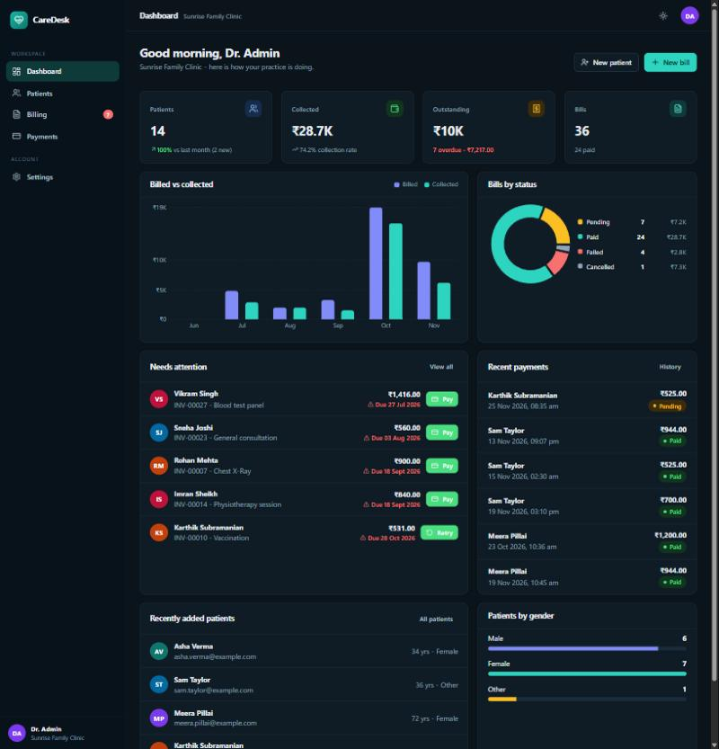

## What you get

| Area | Highlights |
|---|---|
| **Accounts** | Self-service sign-up with a password policy and live strength meter, sign-in, profile (name, clinic), change password, per-IP rate limiting on credential endpoints, bcrypt (cost 12), JWT sessions |
| **Data isolation** | Every clinic account sees **only its own** patients, bills and payments. Ownership is enforced in every query (a foreign id behaves as "not found"), including payment verification |
| **Dashboard** | KPI cards with month-on-month trend, billed-vs-collected chart (6 months), bills-by-status donut, "needs attention" list with one-click pay, recent payments and patients, gender mix, collection rate; guided onboarding for empty accounts |
| **Patients** | Search (name / email / phone), gender filter, sorting, server-side pagination, blood group, clinical notes, per-patient billing totals and outstanding balance, profile page with billing history, CSV export |
| **Billing** | Auto invoice numbers (`INV-00012`), tax with quick-fill rates, **due dates and overdue tracking**, status tabs with live counts, search by patient / service / invoice, sorting, pagination, CSV export |
| **Payments** | Razorpay checkout, retry for failed payments, paginated history with status filters, **printable receipts**, payment timeline on each bill |
| **Invoices** | Print-ready invoice and receipt pages (Print / save as PDF) |
| **UX** | Light and dark theme (follows the system, switchable, remembered), responsive layout with a mobile drawer, skeleton loaders, empty / error / retry states, toast notifications, accessible dialogs (focus, Esc, labels) |

## Screenshots

| | |
|---|---|
| 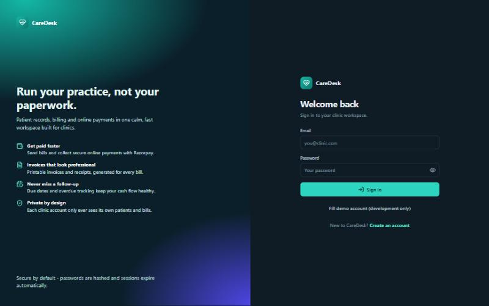 Sign in | 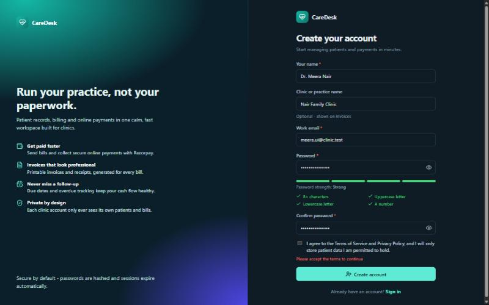 Create an account (strength meter + rules) |
| 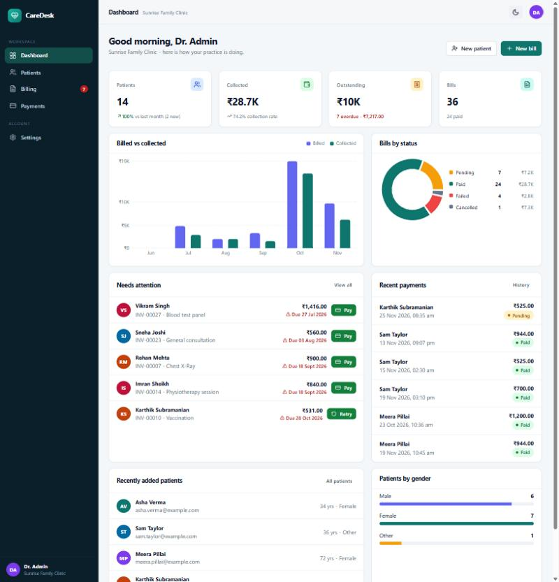 Light theme | 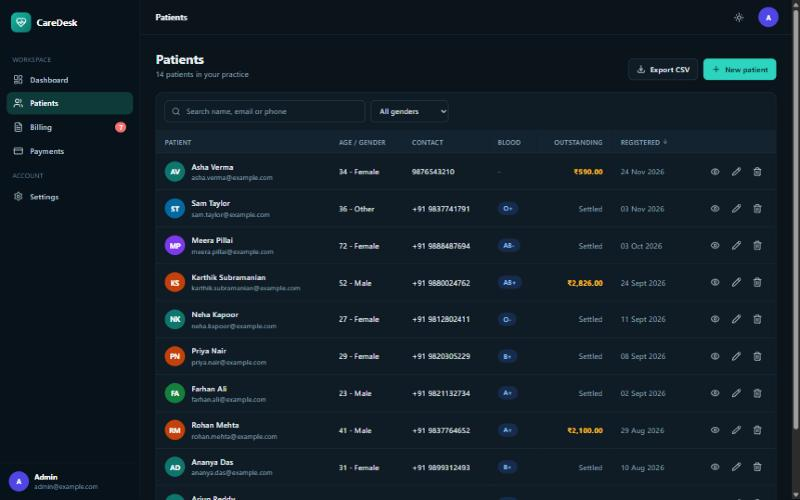 Patients |
| 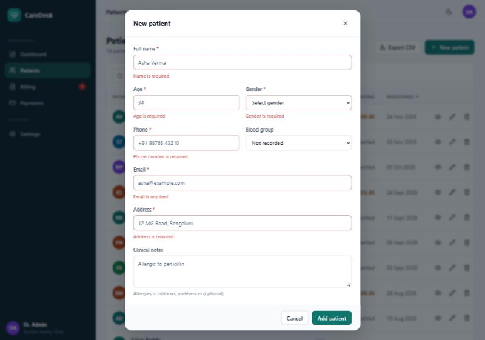 Inline validation | 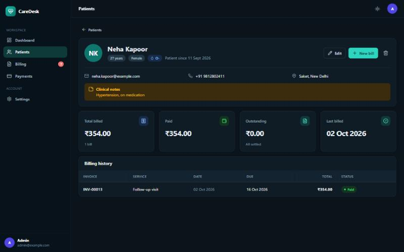 Patient profile |
| 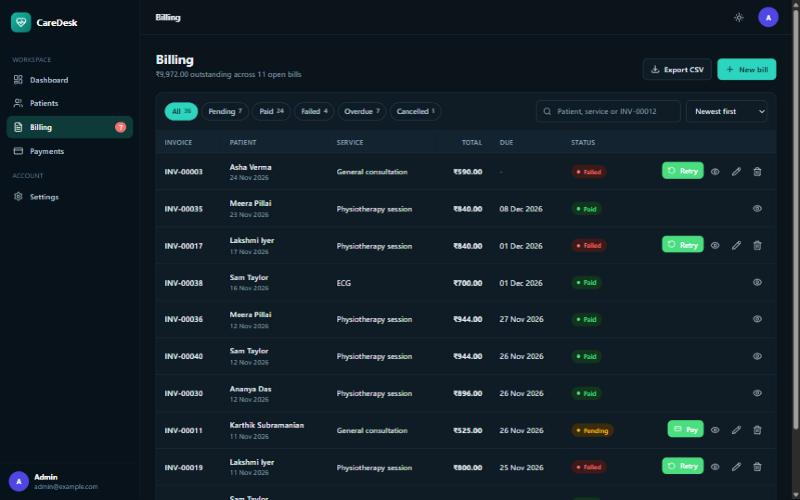 Billing with status tabs | 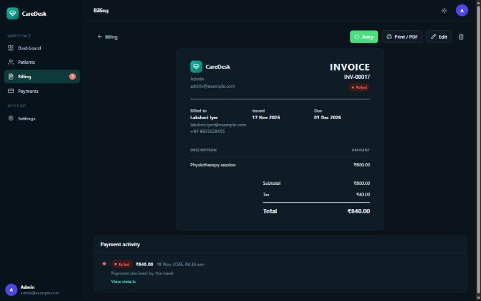 Invoice + payment activity |
| 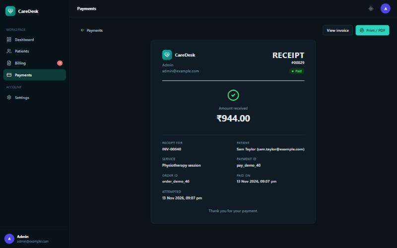 Receipt | 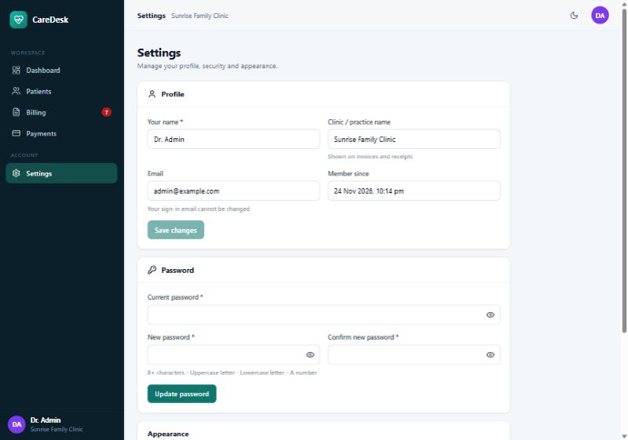 Settings |
| 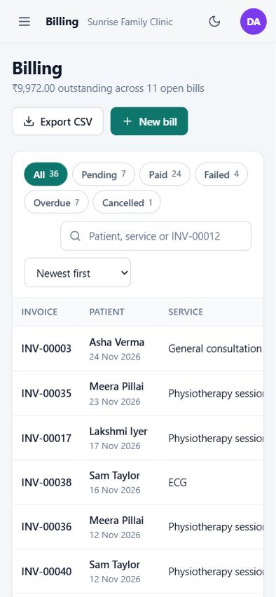 Mobile | 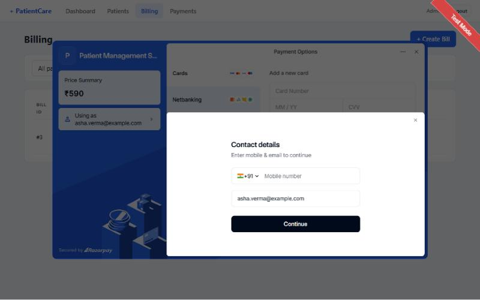 Razorpay checkout |

## Quick start

1. **Database** - local Postgres (`docker compose up -d`, loads `backend/database/schema.sql`) or any hosted Postgres such as Neon.
2. **Backend**
   ```
   cd backend
   cp .env.example .env     # set DATABASE_URL (or DB_*), JWT_SECRET, RAZORPAY_KEY_ID / RAZORPAY_KEY_SECRET
   npm install
   npm run start:dev        # http://localhost:3000/api   Swagger: /api/docs
   npm test                 # 42 unit tests
   npm run seed:demo        # optional: 14 patients / ~35 bills of realistic demo data for the admin account
   ```
   With `DB_SYNC=true` tables are created/updated automatically (development). In production set it to `false` and apply `database/schema.sql` (new database) or `database/migrations/*.sql` (existing database).
3. **Frontend**
   ```
   cd frontend
   npm install
   npm run dev              # http://localhost:5173 (proxies /api to :3000)
   npm run build            # production bundle (charts are code-split)
   ```
4. Open the app and **create an account**, or sign in with the seeded demo account `admin@example.com` / `Admin@123` (configurable with `SEED_ADMIN_*`; change it outside development).

### Upgrading an existing database
`database/migrations/002_accounts_and_tenancy.sql` adds the account columns, per-account patient ownership (existing patients are assigned to the first user), per-account unique patient email, bill due dates and patient profile fields. With `DB_SYNC=true` the same changes are applied automatically on start and orphaned patients are adopted by the seeded admin.

## Project layout

```
backend/src
  auth/ users/        registration, login, profile, password change, JWT guard, @CurrentUser()
  patients/ bills/ payments/ dashboard/   controller -> service -> entity (+ dto/); all scoped by the owning account
  common/             response envelope, exception filter, CSV helper, enums
  seed-demo.ts        optional demo data
backend/database/     schema.sql + migrations/
frontend/src
  api/                axios client (token, 401 handling, CSV download) + service functions
  store/              Redux Toolkit slices: auth, patients, bills, payments, dashboard, ui
  pages/ components/  Dashboard, Patients, Billing, Payments, Settings, Login, Register ...
  index.css           design system (tokens, light/dark themes, components, print styles)
```

## API

All endpoints are under `/api`. Success: `{ success, message, data }`. Errors: `{ success:false, statusCode, message, errors? }`. Everything except `/auth/register` and `/auth/login` needs `Authorization: Bearer <jwt>`. Interactive docs at `/api/docs`.

| Area | Endpoints |
|---|---|
| Auth | `POST /auth/register`, `POST /auth/login`, `GET/PATCH /auth/me`, `POST /auth/change-password` |
| Dashboard | `GET /dashboard/summary` - KPIs, 6-month billed/collected series, status & gender breakdown, recent patients/payments, open bills |
| Patients | `GET /patients?search=&gender=&page=&limit=&sortBy=&order=`, `GET /patients/export` (CSV), `GET/PUT/DELETE /patients/:id`, `POST /patients` |
| Bills | `GET /bills?patientId=&paymentStatus=&overdue=&search=&page=&limit=&sortBy=&order=`, `GET /bills/stats`, `GET /bills/export` (CSV), `GET/PUT/DELETE /bills/:id`, `POST /bills` |
| Payments | `POST /payments/orders`, `POST /payments/verify`, `POST /payments/failed`, `GET /payments?billId=&status=&page=&limit=`, `GET /payments/:id` |

Status codes: 200/201 success, 400 validation, 401 auth, 404 not found (also for records owned by another account), 409 duplicate / conflict (duplicate email, patient has bills, bill already paid), 429 rate limited, 502 Razorpay order failure, 503 Razorpay not configured or database unavailable.

### Business rules
- `totalAmount = amount + tax` (tax is an absolute amount), computed on the server.
- A bill is **overdue** when it is `Pending`/`Failed` and its due date is before today (UTC).
- A bill can be set manually to `Pending` or `Cancelled` only; **`Paid` and `Failed` are written exclusively by the verified payment flow**, so a bill cannot be marked paid without a payment.
- Paid bills cannot be edited or deleted; patients with bills cannot be deleted.
- Patient email is unique **per clinic account**, not globally.

## Security model

- **Authentication:** bcrypt (cost 12), JWT with expiry, identical error for unknown email and wrong password (no user enumeration), password policy enforced on the server (8-72 chars with upper, lower and a digit).
- **Authorisation / isolation:** every service query is scoped by the caller's account id; bills and payments are resolved through patient ownership. Tests cover that foreign ids are `404` and that payment orders/verification cannot cross accounts.
- **Abuse protection:** global rate limit per IP, stricter limits on `/auth/*` (10/min) and on creating Razorpay orders; `helmet` security headers; request validation with a whitelist (`forbidNonWhitelisted`).
- **Data export safety:** CSV exports neutralise spreadsheet formulas (`=`, `+`, `-`, `@`).
- **Secrets:** only in `backend/.env` (git-ignored). The Razorpay secret never reaches the browser - the frontend only receives the public key id.

## Razorpay integration

1. **Pay** -> `POST /payments/orders {billId}`: the backend verifies the bill belongs to the caller and is payable, creates a Razorpay order (amount in paise), stores a `Pending` payment row and returns `orderId`, `amount` and the public `keyId`.
2. The frontend opens Razorpay Checkout with that order.
3. On success Checkout returns `razorpay_order_id`, `razorpay_payment_id`, `razorpay_signature` -> `POST /payments/verify`.
4. The backend recomputes `HMAC_SHA256(order_id|payment_id, KEY_SECRET)`, compares in constant time and, in **one DB transaction** (row-locked), marks the payment and the bill `Paid`. A bad signature marks them `Failed` (400). Verification is idempotent.
5. Checkout's `payment.failed` event calls `POST /payments/failed`; dismissing the dialog leaves the payment `Pending` (superseded by the next attempt). Failed bills show **Retry**.

Test with Razorpay **test mode** keys and the [test card numbers](https://razorpay.com/docs/payments/payments/test-card-details/). Without keys the API still runs and payment endpoints answer 503.

## State management

Redux Toolkit keeps shared state in one place: session and theme (persisted with `redux-persist`), patients, bills, payments, dashboard and toasts. Components dispatch thunks -> thunks call the API -> reducers store data / loading / error. List filters (search, status, sort, page) live in the slices and are executed by the backend; stale responses from fast typing are ignored by request id. Mutations re-fetch the affected list and the status counts. A 401 on any protected call signs the user out.

## Tests

`cd backend && npm test` - 42 unit tests: password policy, auth service (registration, login, enumeration safety, password change), account isolation for patients/bills, overdue and invoice-number rules, dashboard maths, CSV injection safety, Razorpay signature verification.

## Error handling covered

Invalid credentials, weak or mismatched passwords, duplicate account, invalid email/age/amount/due date (client and server validation), duplicate patient email, not-found (including cross-account access), rate limiting, network failure and timeouts (friendly messages with Retry), database failure (mapped to 409/503/500 without leaking details), Razorpay order failure, payment failure / cancel, verification failure and invalid signature.

## Possible next steps

Email verification and password reset (needs an email provider), role-based staff accounts inside one clinic, appointment scheduling, refunds, server-side audit log.
